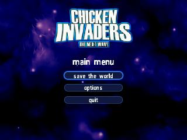
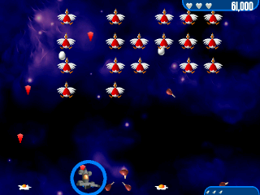
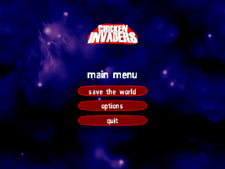

# FroggyCI2

**Open-source Chicken Invaders 2 engine port for the Data Frog SF2000 and GB300
handhelds (multicore firmware).**

FroggyCI2 is a fork of [open-chicken-invaders](https://github.com/konovalov-aleks/open-chicken-invaders)
by Aleksey Konovalov. It keeps the original GPLv2 engine and adds a loader for
the official full-version DAT archives, on-the-fly asset conversion, a 100-wave
campaign, three boss types, a configurable HUD/menu and a native GB300/SF2000
libretro core.

> Chicken Invaders is a trademark of InterAction studios. This project is a
> fan-made engine port and is not affiliated with or endorsed by InterAction
> studios. Game data files are **not** included.




## Features

- **Full-version DAT support** — reads `CI2rm.dat` and `CI2rmXmas.dat` v2
  archives (92-byte TOC records) plus their locale DATs.
- **Demo DAT fallback** — the classic 88-byte demo archive
  (`ChickenInvaders2.dat` / `ChickenInvaders2demo.dat`) is still supported.
- **Streaming loader** — archives are read from disk on demand; the frontend
  never buffers the whole 60 MB DAT in RAM (`need_fullpath = true`).
- **Asset compatibility layer** — TGA/JPEG atlases are sliced with their
  `.ini.preload` tables and converted to BMP; OGG sound effects are decoded to
  PCM WAV with stb_vorbis.
- **Original geometry** — `res/layout.xml` scales the remastered art back to the
  original 640x480 sprite sizes, with tuned scaling for the ship, chickens,
  eggs, HUD, laser and menu.
- **100-wave campaign** — 10 planets x 10 waves, with per-planet wave names and
  formation sizes, extra paratroopers/UFOs, and three boss types:
  Military Chicken, Big Chicken and Mother-Hen Ship.
- **Wave definitions in XML** — edit `res/waves.xml` to change colours, health,
  speeds, egg frequency, asteroid counts, paratrooper/UFO/boss parameters.
- **Display options** — switch between 320x240 output (box-filtered downscale)
  and native 640x480 from the in-game Options menu.
- **Save game** — automatic checkpoints and Continue support (`continue.sav`).
- **Xmas edition** — separate `CI2rmXmas.dat` build with its own launchers,
  red menu/HUD and seasonal bosses and eggs.
- **Direct DAT selection** — launching `CI2rm.dat` or `CI2rmXmas.dat` picks the
  matching asset family even when both sets share a folder.

## Screenshots

| Standard | Xmas |
| --- | --- |
|  |  |
|  | |

## Requirements

### Running

- Data Frog SF2000 or GB300 / GB300V2 with the multicore launcher.
- A patched multicore BIOS (`bios/bisrv.asd`) compatible with your console.
- FAT32 SD card.
- A legally owned copy of Chicken Invaders 2:
  - full/remastered: `CI2rm.dat`, `CI2rm.dat.1250`, `CI2rm.dat.1252`,
    `CI2rm.dat.language.v2`
  - Christmas: `CI2rmXmas.dat` and its `.1250`, `.1252`, `.language.v2`
  - optional legacy demo: `ChickenInvaders2.dat` or
    `ChickenInvaders2demo.dat`
- `CIep2.dat.*` archives use the older `UVE WAD` container and are **not**
  supported by this engine.

### Building

- Host build: a C++17 compiler (`g++`) and `make`.
- MIPS test build: a `mipsel-linux-muslsf` cross toolchain and QEMU if you want
  to run the test runner.
- Device build: the Frog MIPS toolchain plus a
  `sf2000_multicore` checkout (frontend/BIOS).
- Optional for screenshots: `ffmpeg`.

## Quick start

1. Download the latest SD package from the
   [Releases](https://github.com/Synaps33/FroggyCI2/releases) page. It contains
   the cores, launchers, menu resources and both game folders, but **no game DATs and no BIOS**.
2. Extract the package to the root of the SD card.
3. Copy your own DAT files into:
   - `ROMS/chicken/` — `CI2rm.dat` + `.1250` + `.1252` + `.language.v2`
   - `ROMS/chicken_xmas/` — `CI2rmXmas.dat` + locale files
4. Launch **Chicken Invaders 2** or **Chicken Invaders 2 Xmas** from the
   multicore menu. The launchers are `ROMS/ChickenInvaders.gba` and
   `ROMS/ChickenInvadersXmas.gba`.

See [INSTALL.md](INSTALL.md) for the complete SD-card layout, build commands and
troubleshooting.

## Controls

| Input | Action |
| --- | --- |
| D-pad | Move / menu navigation |
| A / B | Fire / confirm |
| X / Y / Start | Launch missile (in game) |
| Select / Escape | Leave intro or menu / back |

## Configuration

- `video.cfg` — saved display mode (`320x240` or `640x480`) next to the game.
- `continue.sav` — checkpoint data for Continue.
- `res/waves.xml` — planet profiles and gameplay balance.
- `res/layout.xml` — original sprite sizes used to scale the remastered art.
- `OCI_DAT` — optional colon-separated override of the DAT search list:
  ```sh
  OCI_DAT="$PWD/CI2rm.dat:$PWD/CI2rm.dat.1250" ./runner/test_runner . 500 screenshots/tour
  ```

## Building from source

### Host runner

```sh
make                 # builds runner/test_runner
make test            # requires ChickenInvaders2.dat and ffmpeg
```

### MIPS soft-float

```sh
make PLATFORM=mips MIPS_CROSS=/path/to/mipsel-linux-muslsf-
make mips-test QEMU=/path/to/qemu-mipsel
```

### GB300 / SF2000 core

```sh
make PLATFORM=sf2000 \
     MIPS=/opt/frog-toolchain/mipsel-mti-elf_stable/bin/mipsel-mti-elf- \
     MULTICORE=/path/to/sf2000_multicore

make -C /path/to/sf2000_multicore clean
make -C /path/to/sf2000_multicore CORE="$PWD" CONSOLE=oci FROGGY_TYPE=GB300V2
```

The resulting core is `sf2000_multicore/build/core_87000000`. Copy it as
`oci.sf2k`, `oci.gb3k` and `core_87000000` as described in
[INSTALL.md](INSTALL.md). For SF2000 use `FROGGY_TYPE=SF2000` instead.

`make device` performs the SF2000 + GB300V2 multicore builds and packaging when
the toolchain and multicore paths are correct.

### Desktop CMake build

```sh
cmake -S . -B build -DUSE_SFML=OFF
cmake --build build -j
```

## Repository layout

- `src/` — engine, game logic, full-version DAT loader, codecs and UI.
- `libretro/oci_libretro.cpp` — libretro core entry point.
- `runner/` — host/MIPS test runner used for screenshots and regression checks.
- `res/` — sprite/font XML, wave profiles, layout data and UI reference assets.
- `third_party/` — stb_image, stb_vorbis.
- `tools/` — packaging helpers.
- `install_to_sd.sh`, `install_two_games.sh` — SD card helpers.

## Credits

- Original engine: Aleksey Konovalov, GPLv2.
- Chicken Invaders 2: InterAction studios.
- stb_image / stb_vorbis: Sean Barrett and contributors (public domain / MIT).
- tinyxml2: Lee Thomason (zlib license).
- GB300/SF2000 multicore tooling and frontend: respective authors.

## License

The engine code is licensed under the GNU GPLv2. See [LICENSE](LICENSE).
Game DAT archives are not distributed with this repository. The small UI
reference bitmaps under `res/images/` are included only to reproduce the
original menu styling; all Chicken Invaders artwork remains the property of
InterAction studios.
